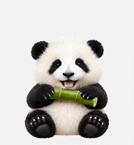

# Codex Pets · 啃啃 🐼

圆脸毛绒小熊猫，抱着竹子认真啃啃，安静陪你工作。

## 文件

- [最终透明精灵图](Pets/kenken-panda/revisions/2026-10-11-chewing/final/spritesheet-extended.png)
- [完整动作 GIF](Pets/kenken-panda/revisions/2026-10-11-chewing/qa/previews-final/all-states.gif)
- [完整动作 MP4](Pets/kenken-panda/revisions/2026-10-11-chewing/qa/previews-final/all-states.mp4)
- [十六个视线方向](Pets/kenken-panda/revisions/2026-10-11-chewing/qa/directions-labeled.png)
- [动作总览](Pets/kenken-panda/revisions/2026-10-11-chewing/qa/contact-sheet-extended.png)
- [最终检查报告](Pets/kenken-panda/revisions/2026-10-11-chewing/qa/pet-quality.json)
- [全部素材](Pets/kenken-panda)
- [文件 SHA-256 清单](backup-manifest.json)

## 动画规格

透明 PNG，1536 × 2288，v2 布局（8 列 × 11 行，每格 192 × 208）。包含九种标准动画与十六个视线方向。待机和工作状态均为坐着啃竹子，包含明确张嘴、咬合和低头动作。

修订版结构检查、质量检查及 Pets 服务预检已通过；未改动的十六个视线方向保留原版通过的独立盲评结果。报告中的细微方向相似和脚掌之间自然透明空隙提示均有视觉复核说明。

## 备份范围

保留原始参考图、生成主形象、动作条带、提取帧、提示词、检查报告、预览与最终精灵图。被拒绝的初版视线条带也保留以便追溯。

本公开副本移除了本机绝对路径和账户关联宠物 ID；图片、动画和最终精灵图保持原始字节。本地原始备份另行保留。

公开版本中的路径为相对路径或脱敏占位符。检查报告记录的是制作时的结果；迁移到其他电脑后需调整路径、安装 Pillow，并准备相应的 Pets 技能脚本后才能重新运行完整管线。这里的素材不会自动创建或选中任何账户的宠物。

制作日期：2026-10-11。图像使用内置 imagegen 生成，基于用户提供的熊猫参考照片。

## 2026-10-11 动作修订

修正待机只抱竹子及工作状态啃咬不明显的问题。只重绘待机与工作两行动画，其余九行像素保持原样。修订素材和检查报告见 [本次修订](Pets/kenken-panda/revisions/2026-10-11-chewing)；原版文件仍保留在上一级目录。修订版已更新到同一只宠物并验证云端图像像素一致。
